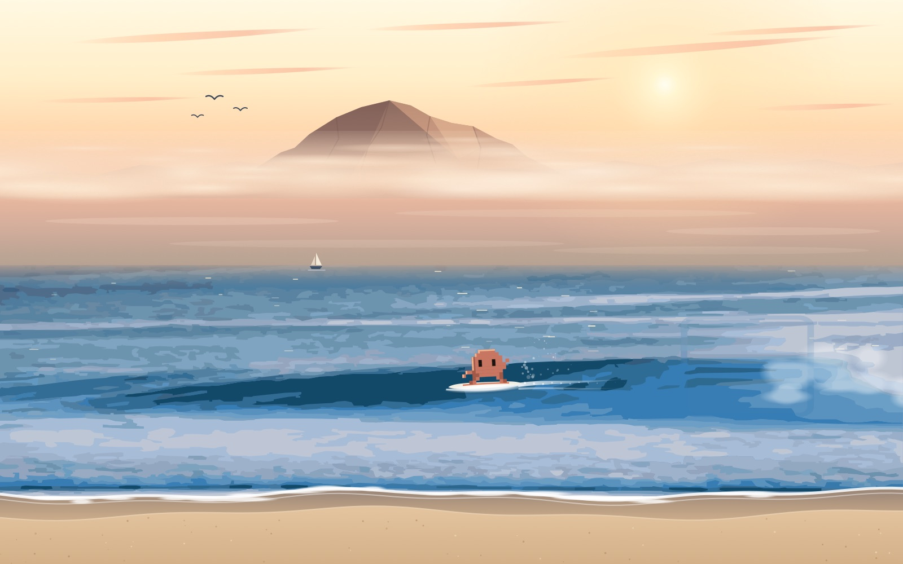

# Nami Waves



A Claude Code theme for the desktop and mobile apps: a sunset surf break below a fog-wrapped mountain, a sandy beach, and a little orange pixel character that surfs the wave while Claude works. The interface colors (surfaces, text, accents) are tuned to the scene, in light and dark mode.

The terminal and editors don't draw themes, so there the mod does nothing.

## Install

At the prompt of a terminal session:

```
/plugin install nami-waves --marketplace shohammezan55-code/claude-surf-theme
```

Answer `y` to add the marketplace, then pick the user scope so the theme applies in every session.

From a shell:

```bash
claude plugin install nami-waves --marketplace shohammezan55-code/claude-surf-theme
```

In the desktop app, where `/plugin` does not run: click + next to the prompt box, then Plugins, Add marketplace with `shohammezan55-code/claude-surf-theme`, then Add plugin.

## Notes

- The background is a vector scene (no images), kept under about 120,000 characters so the desktop app draws it.
- The surfer follows the conversation: it rides while Claude is working, one ride after another of varying length, and stands on the beach with its board while Claude waits for you. A turn that finishes gets a little hop, and one that ends in an error, a wipeout.
- Around it a sailing boat crosses the horizon, a wisp of fog drifts past the mountain, and gulls fly over now and then. In dark mode the scene turns to night, with stars and moonlight on the water.
- Everything moves in steps, twice a second. Each moving thing is its own layer whose drawing never changes; a step only slides a layer or shows and hides one, which is the one kind of change the desktop app draws without reloading the backdrop.
- Remove it with `/plugin uninstall nami-waves`.
